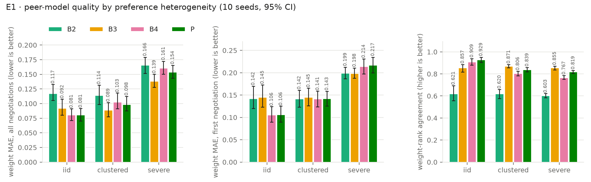
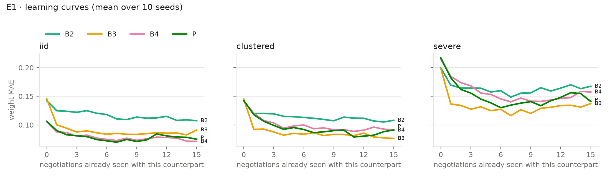
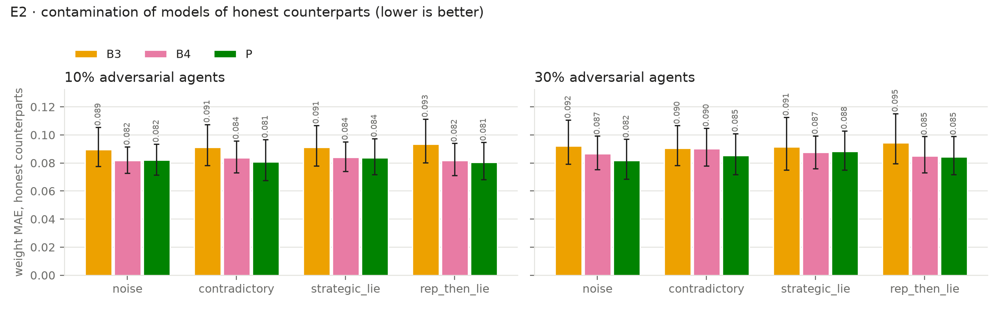
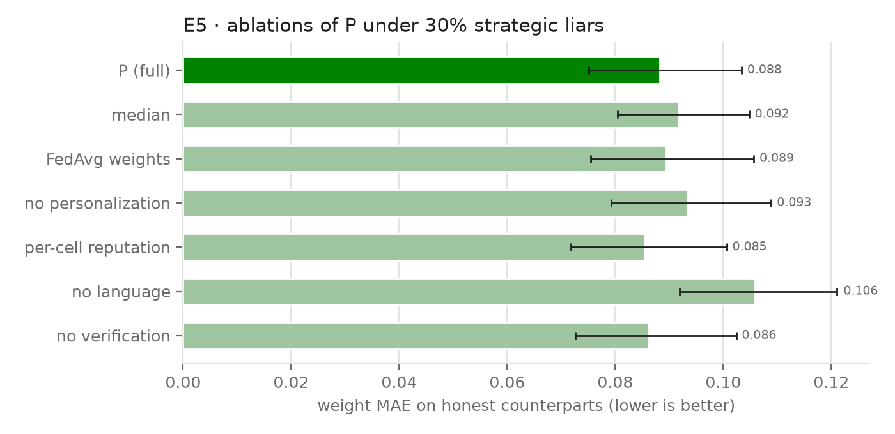
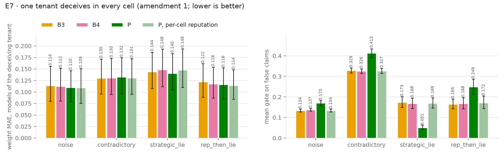

# WP4 results

835 runs. Analysis as pre-registered in `docs/wp4_preregistration.md`. Values are means over seeds ± half-width of the 95% bootstrap CI. Paired differences are oriented so that > 0 means P is better; p is the exact sign-flip test, p_holm is Holm-adjusted within the family.

## Pre-registered tests

### F1 transfer, E1

| scenario | metric | P vs | n | diff | 95% CI | d_z | p | p_holm | |
|---|---|---|---|---|---|---|---|---|---|
| iid | w_mae_mean | B3 | 10 | 0.0113 | [0.0066, 0.0178] | 1.16 | 0.002 | 0.047 | ✔ |
| iid | w_mae_cold | B3 | 10 | 0.0391 | [0.0269, 0.0534] | 1.72 | 0.002 | 0.047 | ✔ |
| iid | rank_mean | B3 | 10 | 0.0718 | [0.0446, 0.1060] | 1.37 | 0.002 | 0.047 | ✔ |
| iid | brier_mean | B3 | 10 | 0.0046 | [-0.0024, 0.0106] | 0.42 | 0.221 | 1.000 |  |
| iid | w_mae_mean | B4 | 10 | -0.0000 | [-0.0024, 0.0022] | -0.01 | 0.971 | 1.000 |  |
| iid | w_mae_cold | B4 | 10 | -0.0004 | [-0.0046, 0.0038] | -0.06 | 0.861 | 1.000 |  |
| iid | rank_mean | B4 | 10 | 0.0194 | [0.0069, 0.0344] | 0.83 | 0.012 | 0.152 |  |
| iid | brier_mean | B4 | 10 | 0.0032 | [0.0008, 0.0055] | 0.78 | 0.039 | 0.312 |  |
| clustered | w_mae_mean | B3 | 10 | -0.0095 | [-0.0152, -0.0036] | -0.95 | 0.021 | 0.215 |  |
| clustered | w_mae_cold | B3 | 10 | 0.0026 | [-0.0068, 0.0101] | 0.18 | 0.592 | 1.000 |  |
| clustered | rank_mean | B3 | 10 | -0.0324 | [-0.0526, -0.0117] | -0.93 | 0.020 | 0.215 |  |
| clustered | brier_mean | B3 | 10 | -0.0038 | [-0.0063, -0.0007] | -0.78 | 0.047 | 0.328 |  |
| clustered | w_mae_mean | B4 | 10 | 0.0044 | [0.0028, 0.0058] | 1.75 | 0.004 | 0.066 |  |
| clustered | w_mae_cold | B4 | 10 | -0.0010 | [-0.0043, 0.0026] | -0.18 | 0.582 | 1.000 |  |
| clustered | rank_mean | B4 | 10 | 0.0333 | [0.0175, 0.0471] | 1.35 | 0.006 | 0.094 |  |
| clustered | brier_mean | B4 | 10 | 0.0043 | [0.0012, 0.0075] | 0.80 | 0.031 | 0.281 |  |
| severe | w_mae_mean | B3 | 10 | -0.0155 | [-0.0204, -0.0108] | -1.89 | 0.002 | 0.047 | ✔ |
| severe | w_mae_cold | B3 | 10 | -0.0186 | [-0.0271, -0.0099] | -1.26 | 0.008 | 0.109 |  |
| severe | rank_mean | B3 | 10 | -0.0361 | [-0.0545, -0.0183] | -1.17 | 0.006 | 0.094 |  |
| severe | brier_mean | B3 | 10 | -0.0163 | [-0.0220, -0.0114] | -1.77 | 0.002 | 0.047 | ✔ |
| severe | w_mae_mean | B4 | 10 | 0.0069 | [0.0045, 0.0094] | 1.67 | 0.002 | 0.047 | ✔ |
| severe | w_mae_cold | B4 | 10 | -0.0026 | [-0.0080, 0.0024] | -0.29 | 0.383 | 1.000 |  |
| severe | rank_mean | B4 | 10 | 0.0515 | [0.0356, 0.0677] | 1.87 | 0.002 | 0.047 | ✔ |
| severe | brier_mean | B4 | 10 | 0.0061 | [0.0024, 0.0094] | 1.01 | 0.018 | 0.211 |  |

### F1b newly joining cells, E4

| scenario | metric | P vs | n | diff | 95% CI | d_z | p | p_holm | |
|---|---|---|---|---|---|---|---|---|---|
| iid | w_mae_cold_late | B3 | 9 | 0.0634 | [0.0427, 0.0839] | 1.91 | 0.004 | 0.031 | ✔ |
| iid | time_to_target | B3 | 10 | 0.0000 | [-0.4000, 0.5000] | 0.00 | 1.000 | 1.000 |  |
| iid | w_mae_cold_late | B4 | 9 | 0.0020 | [-0.0022, 0.0071] | 0.26 | 0.539 | 1.000 |  |
| iid | time_to_target | B4 | 10 | -0.1000 | [-0.3000, 0.0000] | -0.32 | 1.000 | 1.000 |  |
| clustered | w_mae_cold_late | B3 | 9 | 0.0124 | [-0.0144, 0.0371] | 0.30 | 0.375 | 1.000 |  |
| clustered | time_to_target | B3 | 10 | -0.3000 | [-0.6000, 0.0000] | -0.56 | 0.188 | 1.000 |  |
| clustered | w_mae_cold_late | B4 | 9 | 0.0087 | [-0.0024, 0.0194] | 0.48 | 0.180 | 1.000 |  |
| clustered | time_to_target | B4 | 10 | 0.2500 | [-0.1500, 0.6000] | 0.39 | 0.375 | 1.000 |  |

### F2 robustness, E2

| scenario | metric | P vs | n | diff | 95% CI | d_z | p | p_holm | |
|---|---|---|---|---|---|---|---|---|---|
| noise 10% | w_mae_honest_cp | B3 | 10 | 0.0073 | [0.0013, 0.0148] | 0.64 | 0.051 | 0.508 |  |
| noise 10% | w_mae_honest_cp | B4 | 10 | -0.0002 | [-0.0024, 0.0023] | -0.05 | 0.873 | 1.000 |  |
| noise 30% | w_mae_honest_cp | B3 | 10 | 0.0103 | [0.0029, 0.0181] | 0.80 | 0.031 | 0.352 |  |
| noise 30% | w_mae_honest_cp | B4 | 10 | 0.0048 | [0.0018, 0.0082] | 0.87 | 0.021 | 0.301 |  |
| contradictory 10% | w_mae_honest_cp | B3 | 10 | 0.0101 | [0.0066, 0.0135] | 1.73 | 0.002 | 0.031 | ✔ |
| contradictory 10% | w_mae_honest_cp | B4 | 10 | 0.0028 | [-0.0017, 0.0072] | 0.37 | 0.266 | 1.000 |  |
| contradictory 30% | w_mae_honest_cp | B3 | 10 | 0.0051 | [-0.0013, 0.0116] | 0.47 | 0.174 | 1.000 |  |
| contradictory 30% | w_mae_honest_cp | B4 | 10 | 0.0049 | [0.0018, 0.0080] | 0.93 | 0.021 | 0.301 |  |
| strategic_lie 10% | w_mae_honest_cp | B3 | 10 | 0.0073 | [0.0007, 0.0130] | 0.71 | 0.055 | 0.508 |  |
| strategic_lie 10% | w_mae_honest_cp | B4 | 10 | 0.0003 | [-0.0035, 0.0043] | 0.04 | 0.896 | 1.000 |  |
| strategic_lie 30% | w_mae_honest_cp | B3 | 10 | 0.0031 | [-0.0059, 0.0125] | 0.20 | 0.541 | 1.000 |  |
| strategic_lie 30% | w_mae_honest_cp | B4 | 10 | -0.0008 | [-0.0044, 0.0022] | -0.14 | 0.682 | 1.000 |  |
| rep_then_lie 10% | w_mae_honest_cp | B3 | 10 | 0.0128 | [0.0077, 0.0193] | 1.29 | 0.002 | 0.031 | ✔ |
| rep_then_lie 10% | w_mae_honest_cp | B4 | 10 | 0.0013 | [-0.0021, 0.0052] | 0.21 | 0.535 | 1.000 |  |
| rep_then_lie 30% | w_mae_honest_cp | B3 | 10 | 0.0101 | [0.0027, 0.0191] | 0.71 | 0.029 | 0.352 |  |
| rep_then_lie 30% | w_mae_honest_cp | B4 | 10 | 0.0005 | [-0.0026, 0.0035] | 0.10 | 0.760 | 1.000 |  |

### F3 downstream, E1

| scenario | metric | P vs | n | diff | 95% CI | d_z | p | p_holm | |
|---|---|---|---|---|---|---|---|---|---|
| iid | welfare | B3 | 10 | 0.0044 | [-0.0052, 0.0139] | 0.27 | 0.414 | 1.000 |  |
| iid | sla_satisfaction | B3 | 10 | 0.0005 | [-0.0007, 0.0019] | 0.22 | 0.555 | 1.000 |  |
| iid | agreement_rate | B3 | 10 | -0.0010 | [-0.0144, 0.0125] | -0.04 | 0.895 | 1.000 |  |
| iid | jain | B3 | 10 | 0.0014 | [-0.0055, 0.0079] | 0.13 | 0.691 | 1.000 |  |
| clustered | welfare | B3 | 10 | -0.0080 | [-0.0185, 0.0020] | -0.46 | 0.188 | 1.000 |  |
| clustered | sla_satisfaction | B3 | 10 | -0.0006 | [-0.0020, 0.0014] | -0.20 | 0.617 | 1.000 |  |
| clustered | agreement_rate | B3 | 10 | 0.0015 | [-0.0130, 0.0113] | 0.07 | 0.891 | 1.000 |  |
| clustered | jain | B3 | 10 | -0.0083 | [-0.0120, -0.0047] | -1.34 | 0.004 | 0.047 | ✔ |
| severe | welfare | B3 | 10 | -0.0133 | [-0.0268, -0.0024] | -0.63 | 0.059 | 0.586 |  |
| severe | sla_satisfaction | B3 | 10 | 0.0003 | [-0.0013, 0.0017] | 0.11 | 0.768 | 1.000 |  |
| severe | agreement_rate | B3 | 10 | -0.0230 | [-0.0442, -0.0051] | -0.69 | 0.039 | 0.430 |  |
| severe | jain | B3 | 10 | -0.0053 | [-0.0111, 0.0007] | -0.53 | 0.135 | 1.000 |  |

### F4 tenant-level adversaries, amendment 1

| scenario | metric | P vs | n | diff | 95% CI | d_z | p | p_holm | |
|---|---|---|---|---|---|---|---|---|---|
| noise | w_mae_adversarial_cp | P per-cell rep. | 10 | -0.0009 | [-0.0072, 0.0056] | -0.08 | 0.779 | 1.000 |  |
| noise | gate_false | P per-cell rep. | 10 | -0.0358 | [-0.0438, -0.0281] | -2.70 | 0.002 | 0.031 | ✔ |
| noise | w_mae_adversarial_cp | B4 | 10 | 0.0022 | [-0.0025, 0.0069] | 0.28 | 0.391 | 1.000 |  |
| noise | w_mae_adversarial_cp | B3 | 10 | 0.0040 | [-0.0040, 0.0121] | 0.29 | 0.377 | 1.000 |  |
| contradictory | w_mae_adversarial_cp | P per-cell rep. | 10 | -0.0016 | [-0.0039, 0.0009] | -0.40 | 0.240 | 1.000 |  |
| contradictory | gate_false | P per-cell rep. | 10 | -0.0861 | [-0.1093, -0.0658] | -2.30 | 0.002 | 0.031 | ✔ |
| contradictory | w_mae_adversarial_cp | B4 | 10 | -0.0019 | [-0.0041, 0.0003] | -0.50 | 0.133 | 1.000 |  |
| contradictory | w_mae_adversarial_cp | B3 | 10 | -0.0022 | [-0.0061, 0.0014] | -0.35 | 0.301 | 1.000 |  |
| strategic_lie | w_mae_adversarial_cp | P per-cell rep. | 10 | 0.0076 | [-0.0003, 0.0162] | 0.54 | 0.131 | 1.000 |  |
| strategic_lie | gate_false | P per-cell rep. | 10 | 0.1186 | [0.1024, 0.1361] | 4.15 | 0.002 | 0.031 | ✔ |
| strategic_lie | w_mae_adversarial_cp | B4 | 10 | 0.0081 | [-0.0005, 0.0177] | 0.52 | 0.145 | 1.000 |  |
| strategic_lie | w_mae_adversarial_cp | B3 | 10 | 0.0034 | [-0.0018, 0.0093] | 0.37 | 0.303 | 1.000 |  |
| rep_then_lie | w_mae_adversarial_cp | P per-cell rep. | 10 | -0.0021 | [-0.0056, 0.0011] | -0.39 | 0.256 | 1.000 |  |
| rep_then_lie | gate_false | P per-cell rep. | 10 | -0.0780 | [-0.1105, -0.0440] | -1.37 | 0.004 | 0.051 |  |
| rep_then_lie | w_mae_adversarial_cp | B4 | 10 | 0.0014 | [-0.0031, 0.0059] | 0.18 | 0.537 | 1.000 |  |
| rep_then_lie | w_mae_adversarial_cp | B3 | 10 | 0.0058 | [-0.0015, 0.0140] | 0.44 | 0.205 | 1.000 |  |

## E1 · heterogeneity (honest senders)

**iid**

| | n | w_mae_mean | w_mae_cold | rank_mean | brier_mean | time_to_target | welfare | nash_gap | jain | sla_satisfaction | agreement_rate |
|---|---|---|---|---|---|---|---|---|---|---|---|
| B0 | 10 | – | – | – | – | – | – | – | – | 0.937 ±0.005 | – |
| B1 | 10 | – | – | – | – | – | 1.209 ±0.058 | 0.000 ±0.000 | 0.912 ±0.025 | 0.988 ±0.003 | 0.861 ±0.088 |
| B2 | 10 | 0.117 ±0.013 | 0.142 ±0.025 | 0.621 ±0.068 | 0.041 ±0.011 | 1.350 ±0.750 | 1.175 ±0.059 | 0.009 ±0.004 | 0.895 ±0.025 | 0.988 ±0.003 | 0.843 ±0.120 |
| B3 | 10 | 0.092 ±0.014 | 0.145 ±0.025 | 0.857 ±0.033 | 0.047 ±0.013 | 1.350 ±0.451 | 1.179 ±0.060 | 0.009 ±0.003 | 0.894 ±0.025 | 0.989 ±0.003 | 0.843 ±0.128 |
| B4 | 10 | 0.081 ±0.010 | 0.106 ±0.018 | 0.909 ±0.030 | 0.046 ±0.017 | 1.200 ±0.350 | 1.182 ±0.058 | 0.008 ±0.003 | 0.899 ±0.024 | 0.989 ±0.003 | 0.847 ±0.124 |
| P | 10 | 0.081 ±0.011 | 0.106 ±0.018 | 0.929 ±0.024 | 0.043 ±0.016 | 1.250 ±0.350 | 1.183 ±0.058 | 0.008 ±0.003 | 0.895 ±0.023 | 0.990 ±0.002 | 0.842 ±0.126 |

**clustered**

| | n | w_mae_mean | w_mae_cold | rank_mean | brier_mean | time_to_target | welfare | nash_gap | jain | sla_satisfaction | agreement_rate |
|---|---|---|---|---|---|---|---|---|---|---|---|
| B0 | 10 | – | – | – | – | – | – | – | – | 0.937 ±0.005 | – |
| B1 | 10 | – | – | – | – | – | 1.218 ±0.048 | 0.000 ±0.000 | 0.916 ±0.018 | 0.989 ±0.002 | 0.930 ±0.042 |
| B2 | 10 | 0.114 ±0.016 | 0.142 ±0.019 | 0.620 ±0.042 | 0.039 ±0.003 | 1.250 ±0.250 | 1.186 ±0.048 | 0.008 ±0.001 | 0.906 ±0.014 | 0.988 ±0.002 | 0.904 ±0.053 |
| B3 | 10 | 0.089 ±0.012 | 0.145 ±0.019 | 0.871 ±0.014 | 0.044 ±0.003 | 1.200 ±0.300 | 1.187 ±0.047 | 0.008 ±0.001 | 0.913 ±0.014 | 0.989 ±0.001 | 0.895 ±0.058 |
| B4 | 10 | 0.103 ±0.013 | 0.141 ±0.017 | 0.806 ±0.020 | 0.052 ±0.006 | 1.750 ±0.525 | 1.179 ±0.041 | 0.008 ±0.002 | 0.904 ±0.012 | 0.990 ±0.002 | 0.889 ±0.062 |
| P | 10 | 0.098 ±0.012 | 0.143 ±0.017 | 0.839 ±0.019 | 0.048 ±0.003 | 1.800 ±0.700 | 1.179 ±0.048 | 0.009 ±0.002 | 0.904 ±0.013 | 0.989 ±0.002 | 0.897 ±0.065 |

**severe**

| | n | w_mae_mean | w_mae_cold | rank_mean | brier_mean | time_to_target | welfare | nash_gap | jain | sla_satisfaction | agreement_rate |
|---|---|---|---|---|---|---|---|---|---|---|---|
| B0 | 10 | – | – | – | – | – | – | – | – | 0.937 ±0.005 | – |
| B1 | 10 | – | – | – | – | – | 1.338 ±0.028 | 0.000 ±0.000 | 0.919 ±0.007 | 0.989 ±0.002 | 0.924 ±0.027 |
| B2 | 10 | 0.166 ±0.014 | 0.199 ±0.013 | 0.603 ±0.020 | 0.046 ±0.005 | 1.800 ±0.700 | 1.299 ±0.039 | 0.011 ±0.002 | 0.914 ±0.007 | 0.991 ±0.002 | 0.881 ±0.049 |
| B3 | 10 | 0.139 ±0.012 | 0.198 ±0.012 | 0.855 ±0.017 | 0.050 ±0.005 | 1.600 ±0.675 | 1.300 ±0.041 | 0.010 ±0.002 | 0.917 ±0.009 | 0.990 ±0.002 | 0.898 ±0.036 |
| B4 | 10 | 0.161 ±0.011 | 0.214 ±0.017 | 0.767 ±0.017 | 0.072 ±0.006 | 2.350 ±0.475 | 1.291 ±0.043 | 0.010 ±0.001 | 0.915 ±0.009 | 0.990 ±0.002 | 0.893 ±0.041 |
| P | 10 | 0.154 ±0.011 | 0.217 ±0.017 | 0.819 ±0.014 | 0.066 ±0.006 | 2.000 ±0.300 | 1.287 ±0.037 | 0.010 ±0.002 | 0.912 ±0.008 | 0.991 ±0.003 | 0.875 ±0.044 |

Leakage and cost (iid):

| | n | leak_mean | leak_aggregator | messages | fl_bytes | seconds |
|---|---|---|---|---|---|---|
| B2 | 10 | -0.153 ±0.417 | – | – | – | 6.348 ±1.037 |
| B3 | 10 | 0.206 ±0.218 | – | 2089.100 ±388.404 | 0.000 ±0.000 | 9.604 ±2.156 |
| B4 | 10 | 0.286 ±0.152 | 0.385 ±0.073 | 2130.500 ±321.556 | 112348.800 ±8114.580 | 8.843 ±2.005 |
| P | 10 | 0.275 ±0.193 | 0.334 ±0.076 | 2070.800 ±365.161 | 111686.400 ±8006.580 | 11.457 ±2.225 |

## E2 · corruption (iid preferences)

**noise, 10% adversarial**

| | n | w_mae_honest_cp | w_mae_adversarial_cp | gate_true | gate_false | false_admission_rate | extraction_f1 | welfare |
|---|---|---|---|---|---|---|---|---|
| B3 | 10 | 0.089 ±0.014 | 0.104 ±0.015 | 0.675 ±0.019 | 0.123 ±0.010 | 0.002 ±0.002 | 0.925 ±0.007 | 1.176 ±0.061 |
| B4 | 10 | 0.082 ±0.009 | 0.092 ±0.016 | 0.675 ±0.020 | 0.119 ±0.015 | 0.003 ±0.003 | 0.925 ±0.008 | 1.182 ±0.057 |
| P | 10 | 0.082 ±0.011 | 0.093 ±0.018 | 0.794 ±0.008 | 0.157 ±0.017 | 0.041 ±0.011 | 0.925 ±0.009 | 1.179 ±0.059 |

**noise, 30% adversarial**

| | n | w_mae_honest_cp | w_mae_adversarial_cp | gate_true | gate_false | false_admission_rate | extraction_f1 | welfare |
|---|---|---|---|---|---|---|---|---|
| B3 | 10 | 0.092 ±0.015 | 0.105 ±0.014 | 0.656 ±0.019 | 0.136 ±0.012 | 0.007 ±0.002 | 0.871 ±0.019 | 1.179 ±0.062 |
| B4 | 10 | 0.087 ±0.012 | 0.095 ±0.017 | 0.644 ±0.020 | 0.137 ±0.011 | 0.004 ±0.002 | 0.866 ±0.022 | 1.184 ±0.060 |
| P | 10 | 0.082 ±0.014 | 0.098 ±0.018 | 0.763 ±0.014 | 0.175 ±0.013 | 0.034 ±0.007 | 0.868 ±0.020 | 1.184 ±0.062 |

**contradictory, 10% adversarial**

| | n | w_mae_honest_cp | w_mae_adversarial_cp | gate_true | gate_false | false_admission_rate | extraction_f1 | welfare |
|---|---|---|---|---|---|---|---|---|
| B3 | 10 | 0.091 ±0.015 | 0.122 ±0.020 | 0.667 ±0.018 | 0.295 ±0.020 | 0.136 ±0.029 | 0.962 ±0.001 | 1.178 ±0.062 |
| B4 | 10 | 0.084 ±0.011 | 0.103 ±0.017 | 0.669 ±0.019 | 0.289 ±0.022 | 0.121 ±0.044 | 0.963 ±0.002 | 1.179 ±0.060 |
| P | 10 | 0.081 ±0.015 | 0.110 ±0.018 | 0.786 ±0.009 | 0.371 ±0.029 | 0.291 ±0.040 | 0.963 ±0.001 | 1.180 ±0.061 |

**contradictory, 30% adversarial**

| | n | w_mae_honest_cp | w_mae_adversarial_cp | gate_true | gate_false | false_admission_rate | extraction_f1 | welfare |
|---|---|---|---|---|---|---|---|---|
| B3 | 10 | 0.090 ±0.014 | 0.126 ±0.017 | 0.634 ±0.023 | 0.334 ±0.015 | 0.144 ±0.024 | 0.963 ±0.001 | 1.173 ±0.059 |
| B4 | 10 | 0.090 ±0.014 | 0.116 ±0.020 | 0.630 ±0.022 | 0.335 ±0.013 | 0.152 ±0.019 | 0.962 ±0.001 | 1.181 ±0.060 |
| P | 10 | 0.085 ±0.014 | 0.116 ±0.021 | 0.744 ±0.017 | 0.409 ±0.015 | 0.308 ±0.031 | 0.963 ±0.001 | 1.184 ±0.062 |

**strategic_lie, 10% adversarial**

| | n | w_mae_honest_cp | w_mae_adversarial_cp | gate_true | gate_false | false_admission_rate | extraction_f1 | welfare |
|---|---|---|---|---|---|---|---|---|
| B3 | 10 | 0.091 ±0.015 | 0.137 ±0.018 | 0.672 ±0.019 | 0.164 ±0.019 | 0.001 ±0.001 | 0.962 ±0.001 | 1.180 ±0.063 |
| B4 | 10 | 0.084 ±0.010 | 0.107 ±0.019 | 0.679 ±0.017 | 0.165 ±0.026 | 0.001 ±0.001 | 0.963 ±0.001 | 1.179 ±0.056 |
| P | 10 | 0.084 ±0.013 | 0.134 ±0.021 | 0.724 ±0.033 | 0.558 ±0.020 | 0.690 ±0.059 | 0.963 ±0.002 | 1.178 ±0.059 |

**strategic_lie, 30% adversarial**

| | n | w_mae_honest_cp | w_mae_adversarial_cp | gate_true | gate_false | false_admission_rate | extraction_f1 | welfare |
|---|---|---|---|---|---|---|---|---|
| B3 | 10 | 0.091 ±0.019 | 0.144 ±0.017 | 0.650 ±0.022 | 0.169 ±0.024 | 0.000 ±0.000 | 0.962 ±0.001 | 1.173 ±0.065 |
| B4 | 10 | 0.087 ±0.012 | 0.117 ±0.016 | 0.648 ±0.022 | 0.169 ±0.024 | 0.000 ±0.000 | 0.963 ±0.001 | 1.178 ±0.057 |
| P | 10 | 0.088 ±0.014 | 0.137 ±0.021 | 0.587 ±0.056 | 0.467 ±0.054 | 0.456 ±0.135 | 0.963 ±0.001 | 1.181 ±0.061 |

**rep_then_lie, 10% adversarial**

| | n | w_mae_honest_cp | w_mae_adversarial_cp | gate_true | gate_false | false_admission_rate | extraction_f1 | welfare |
|---|---|---|---|---|---|---|---|---|
| B3 | 10 | 0.093 ±0.015 | 0.115 ±0.021 | 0.670 ±0.020 | 0.162 ±0.030 | 0.022 ±0.018 | 0.962 ±0.002 | 1.180 ±0.062 |
| B4 | 10 | 0.082 ±0.011 | 0.096 ±0.018 | 0.675 ±0.018 | 0.162 ±0.030 | 0.011 ±0.008 | 0.962 ±0.001 | 1.181 ±0.060 |
| P | 10 | 0.081 ±0.013 | 0.115 ±0.018 | 0.765 ±0.011 | 0.522 ±0.030 | 0.628 ±0.069 | 0.962 ±0.001 | 1.182 ±0.058 |

**rep_then_lie, 30% adversarial**

| | n | w_mae_honest_cp | w_mae_adversarial_cp | gate_true | gate_false | false_admission_rate | extraction_f1 | welfare |
|---|---|---|---|---|---|---|---|---|
| B3 | 10 | 0.095 ±0.018 | 0.119 ±0.014 | 0.651 ±0.021 | 0.173 ±0.023 | 0.021 ±0.013 | 0.962 ±0.001 | 1.178 ±0.061 |
| B4 | 10 | 0.085 ±0.013 | 0.102 ±0.016 | 0.649 ±0.019 | 0.173 ±0.026 | 0.015 ±0.009 | 0.962 ±0.001 | 1.178 ±0.057 |
| P | 10 | 0.085 ±0.014 | 0.116 ±0.020 | 0.699 ±0.019 | 0.478 ±0.038 | 0.465 ±0.081 | 0.962 ±0.001 | 1.179 ±0.058 |

## E3 · deadlines (iid)

**T_max = 5**

| | n | agreement_rate | timeout_rate | no_agreement_rate | rounds_agreed | welfare | w_mae_mean |
|---|---|---|---|---|---|---|---|
| B2 | 5 | 0.781 ±0.196 | 0.045 ±0.032 | 0.174 ±0.212 | 3.929 ±0.168 | 1.167 ±0.065 | 0.119 ±0.011 |
| B3 | 5 | 0.810 ±0.193 | 0.027 ±0.019 | 0.163 ±0.202 | 3.888 ±0.168 | 1.180 ±0.064 | 0.097 ±0.008 |
| B4 | 5 | 0.805 ±0.194 | 0.033 ±0.032 | 0.162 ±0.200 | 3.881 ±0.160 | 1.182 ±0.069 | 0.084 ±0.007 |
| P | 5 | 0.792 ±0.207 | 0.039 ±0.041 | 0.169 ±0.213 | 3.884 ±0.150 | 1.180 ±0.059 | 0.082 ±0.010 |

**T_max = 10**

| | n | agreement_rate | timeout_rate | no_agreement_rate | rounds_agreed | welfare | w_mae_mean |
|---|---|---|---|---|---|---|---|
| B2 | 5 | 0.810 ±0.191 | 0.036 ±0.030 | 0.154 ±0.196 | 7.479 ±0.309 | 1.194 ±0.074 | 0.117 ±0.007 |
| B3 | 5 | 0.824 ±0.197 | 0.028 ±0.019 | 0.148 ±0.201 | 7.501 ±0.322 | 1.196 ±0.074 | 0.093 ±0.007 |
| B4 | 5 | 0.817 ±0.200 | 0.037 ±0.031 | 0.146 ±0.201 | 7.471 ±0.298 | 1.202 ±0.069 | 0.085 ±0.008 |
| P | 5 | 0.816 ±0.203 | 0.031 ±0.025 | 0.153 ±0.204 | 7.519 ±0.294 | 1.199 ±0.065 | 0.086 ±0.009 |

**T_max = 20**

| | n | agreement_rate | timeout_rate | no_agreement_rate | rounds_agreed | welfare | w_mae_mean |
|---|---|---|---|---|---|---|---|
| B2 | 5 | 0.802 ±0.198 | 0.034 ±0.025 | 0.164 ±0.208 | 14.653 ±0.662 | 1.206 ±0.068 | 0.119 ±0.008 |
| B3 | 5 | 0.808 ±0.200 | 0.026 ±0.018 | 0.166 ±0.208 | 14.493 ±0.642 | 1.214 ±0.068 | 0.092 ±0.005 |
| B4 | 5 | 0.817 ±0.200 | 0.032 ±0.023 | 0.151 ±0.205 | 14.561 ±0.627 | 1.213 ±0.066 | 0.085 ±0.007 |
| P | 5 | 0.814 ±0.201 | 0.033 ±0.025 | 0.153 ±0.207 | 14.716 ±0.574 | 1.207 ±0.057 | 0.083 ±0.006 |

## E4 · newly joining cells and scale

**30% of cells join at mid-horizon, iid**

| | n | w_mae_cold_late | w_mae_cold | time_to_target | target_reached | w_mae_mean |
|---|---|---|---|---|---|---|
| B3 | 10 | 0.154 ±0.023 | 0.150 ±0.025 | 1.200 ±0.250 | 0.680 ±0.088 | 0.091 ±0.014 |
| B4 | 10 | 0.093 ±0.023 | 0.109 ±0.017 | 1.100 ±0.300 | 0.737 ±0.095 | 0.083 ±0.012 |
| P | 10 | 0.091 ±0.021 | 0.107 ±0.017 | 1.200 ±0.400 | 0.734 ±0.081 | 0.083 ±0.014 |

**30% of cells join at mid-horizon, clustered**

| | n | w_mae_cold_late | w_mae_cold | time_to_target | target_reached | w_mae_mean |
|---|---|---|---|---|---|---|
| B3 | 10 | 0.149 ±0.028 | 0.146 ±0.020 | 1.250 ±0.325 | 0.682 ±0.072 | 0.089 ±0.011 |
| B4 | 10 | 0.145 ±0.024 | 0.146 ±0.012 | 1.800 ±0.250 | 0.680 ±0.058 | 0.101 ±0.011 |
| P | 10 | 0.136 ±0.027 | 0.142 ±0.015 | 1.550 ±0.400 | 0.683 ±0.082 | 0.098 ±0.012 |

**20 cells, iid**

| | n | w_mae_mean | w_mae_cold | rank_mean | fl_bytes | seconds |
|---|---|---|---|---|---|---|
| B3 | 5 | 0.096 ±0.027 | 0.177 ±0.051 | 0.868 ±0.022 | 0.000 ±0.000 | 14.923 ±2.731 |
| B4 | 5 | 0.081 ±0.023 | 0.100 ±0.026 | 0.931 ±0.017 | 233049.600 ±18921.600 | 12.875 ±2.086 |
| P | 5 | 0.077 ±0.021 | 0.098 ±0.027 | 0.942 ±0.006 | 233654.400 ±17074.800 | 13.738 ±2.392 |

## E5 · ablations of P (30% strategic liars, iid)

| | n | w_mae_honest_cp | w_mae_mean | rank_mean | gate_false | welfare |
|---|---|---|---|---|---|---|
| B3 | 10 | 0.091 ±0.019 | 0.110 ±0.015 | 0.682 ±0.066 | 0.169 ±0.024 | 1.173 ±0.065 |
| B4 | 10 | 0.087 ±0.012 | 0.099 ±0.012 | 0.772 ±0.068 | 0.169 ±0.024 | 1.178 ±0.057 |
| P | 10 | 0.088 ±0.014 | 0.106 ±0.015 | 0.720 ±0.075 | 0.467 ±0.054 | 1.181 ±0.061 |
| P, aggregation=median | 10 | 0.092 ±0.012 | 0.109 ±0.013 | 0.698 ±0.083 | 0.456 ±0.064 | 1.174 ±0.060 |
| P, aggregation=fedavg | 10 | 0.089 ±0.015 | 0.107 ±0.016 | 0.715 ±0.075 | 0.459 ±0.061 | 1.176 ±0.059 |
| P, personalize=False | 10 | 0.093 ±0.015 | 0.108 ±0.015 | 0.717 ±0.079 | 0.454 ±0.057 | 1.176 ±0.058 |
| P, pooled_reputation=False | 10 | 0.085 ±0.015 | 0.098 ±0.015 | 0.788 ±0.056 | 0.167 ±0.021 | 1.177 ±0.060 |
| P, language=False | 10 | 0.106 ±0.015 | 0.104 ±0.012 | 0.697 ±0.073 | 0.458 ±0.054 | 1.184 ±0.053 |
| P, verification=False | 10 | 0.086 ±0.015 | 0.104 ±0.016 | 0.715 ±0.080 | 0.404 ±0.011 | 1.173 ±0.059 |

## E7 · tenant-level adversaries (amendment 1, iid)

One tenant uses the regime in every cell. `P*` = P with per-cell instead of pooled reputation.

**noise**

| | n | w_mae_adversarial_cp | w_mae_honest_cp | gate_true | gate_false | rank_mean | welfare |
|---|---|---|---|---|---|---|---|
| B3 | 10 | 0.114 ±0.038 | 0.089 ±0.011 | 0.653 ±0.016 | 0.134 ±0.008 | 0.835 ±0.033 | 1.173 ±0.057 |
| B4 | 10 | 0.112 ±0.036 | 0.083 ±0.011 | 0.651 ±0.018 | 0.137 ±0.007 | 0.892 ±0.028 | 1.185 ±0.059 |
| P | 10 | 0.110 ±0.033 | 0.078 ±0.010 | 0.768 ±0.009 | 0.170 ±0.012 | 0.914 ±0.027 | 1.186 ±0.061 |
| P* | 10 | 0.109 ±0.037 | 0.079 ±0.011 | 0.649 ±0.017 | 0.134 ±0.007 | 0.912 ±0.019 | 1.184 ±0.058 |

**contradictory**

| | n | w_mae_adversarial_cp | w_mae_honest_cp | gate_true | gate_false | rank_mean | welfare |
|---|---|---|---|---|---|---|---|
| B3 | 10 | 0.130 ±0.039 | 0.088 ±0.011 | 0.640 ±0.017 | 0.329 ±0.012 | 0.769 ±0.042 | 1.172 ±0.059 |
| B4 | 10 | 0.130 ±0.039 | 0.078 ±0.012 | 0.639 ±0.019 | 0.326 ±0.011 | 0.820 ±0.044 | 1.183 ±0.060 |
| P | 10 | 0.132 ±0.040 | 0.080 ±0.012 | 0.758 ±0.013 | 0.413 ±0.020 | 0.834 ±0.031 | 1.182 ±0.061 |
| P* | 10 | 0.131 ±0.039 | 0.079 ±0.013 | 0.635 ±0.018 | 0.327 ±0.012 | 0.814 ±0.044 | 1.177 ±0.057 |

**strategic_lie**

| | n | w_mae_adversarial_cp | w_mae_honest_cp | gate_true | gate_false | rank_mean | welfare |
|---|---|---|---|---|---|---|---|
| B3 | 10 | 0.144 ±0.040 | 0.087 ±0.012 | 0.656 ±0.017 | 0.173 ±0.026 | 0.701 ±0.051 | 1.171 ±0.062 |
| B4 | 10 | 0.148 ±0.041 | 0.079 ±0.012 | 0.658 ±0.013 | 0.168 ±0.026 | 0.751 ±0.050 | 1.177 ±0.061 |
| P | 10 | 0.140 ±0.039 | 0.077 ±0.013 | 0.766 ±0.015 | 0.051 ±0.010 | 0.804 ±0.044 | 1.180 ±0.062 |
| P* | 10 | 0.148 ±0.041 | 0.078 ±0.013 | 0.659 ±0.014 | 0.169 ±0.026 | 0.754 ±0.059 | 1.174 ±0.061 |

**rep_then_lie**

| | n | w_mae_adversarial_cp | w_mae_honest_cp | gate_true | gate_false | rank_mean | welfare |
|---|---|---|---|---|---|---|---|
| B3 | 10 | 0.122 ±0.037 | 0.087 ±0.011 | 0.662 ±0.019 | 0.165 ±0.024 | 0.788 ±0.043 | 1.171 ±0.060 |
| B4 | 10 | 0.118 ±0.034 | 0.080 ±0.012 | 0.665 ±0.014 | 0.168 ±0.028 | 0.855 ±0.044 | 1.180 ±0.058 |
| P | 10 | 0.116 ±0.033 | 0.080 ±0.012 | 0.782 ±0.011 | 0.249 ±0.034 | 0.863 ±0.042 | 1.178 ±0.058 |
| P* | 10 | 0.114 ±0.032 | 0.078 ±0.012 | 0.663 ±0.019 | 0.172 ±0.029 | 0.876 ±0.040 | 1.183 ±0.059 |

**Ablations of P, strategic_lie**

| | n | w_mae_adversarial_cp | w_mae_honest_cp | gate_false | rank_mean |
|---|---|---|---|---|---|
| P | 10 | 0.140 ±0.039 | 0.077 ±0.013 | 0.051 ±0.010 | 0.804 ±0.043 |
| P* | 10 | 0.148 ±0.042 | 0.078 ±0.013 | 0.169 ±0.025 | 0.754 ±0.059 |
| P, aggregation=median | 10 | 0.142 ±0.045 | 0.076 ±0.011 | 0.049 ±0.013 | 0.794 ±0.047 |
| P, aggregation=fedavg | 10 | 0.141 ±0.042 | 0.077 ±0.012 | 0.050 ±0.010 | 0.800 ±0.045 |
| P, personalize=False | 10 | 0.137 ±0.039 | 0.078 ±0.012 | 0.048 ±0.011 | 0.809 ±0.039 |
| P, language=False | 10 | 0.117 ±0.035 | 0.101 ±0.015 | 0.051 ±0.013 | 0.697 ±0.073 |
| P, verification=False | 10 | 0.166 ±0.041 | 0.078 ±0.012 | 0.398 ±0.005 | 0.701 ±0.054 |

## E6 · sensitivity of P (iid, honest)

| | n | w_mae_mean | w_mae_cold | rank_mean | welfare | fl_bytes |
|---|---|---|---|---|---|---|
| P (μ=10, sync 4, λ=0.7) | 5 | 0.086 ±0.009 | 0.110 ±0.021 | 0.934 ±0.013 | 1.199 ±0.063 | 111340.800 ±10915.200 |
| P, mu=1.0 | 5 | 0.087 ±0.011 | 0.111 ±0.020 | 0.945 ±0.015 | 1.197 ±0.073 | 112118.400 ±11462.400 |
| P, mu=100.0 | 5 | 0.084 ±0.009 | 0.109 ±0.020 | 0.916 ±0.008 | 1.204 ±0.068 | 111628.800 ±10526.400 |
| P, sync_epochs=2 | 5 | 0.086 ±0.008 | 0.112 ±0.019 | 0.934 ±0.009 | 1.203 ±0.063 | 223891.200 ±18864.000 |
| P, sync_epochs=8 | 5 | 0.084 ±0.009 | 0.112 ±0.021 | 0.937 ±0.016 | 1.201 ±0.063 | 53539.200 ±5673.600 |
| P, lam=0.5 | 5 | 0.079 ±0.007 | 0.109 ±0.024 | 0.938 ±0.006 | 1.201 ±0.070 | 112752.000 ±10195.200 |
| P, lam=0.9 | 5 | 0.086 ±0.012 | 0.113 ±0.024 | 0.940 ±0.009 | 1.185 ±0.074 | 110995.200 ±8193.600 |
